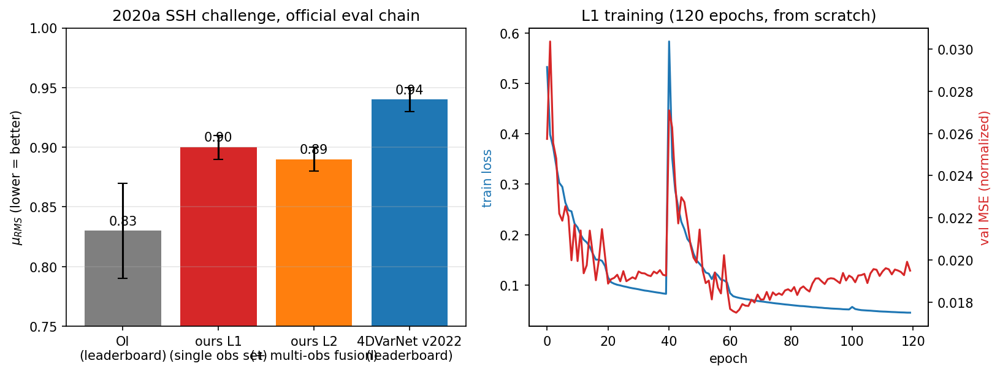
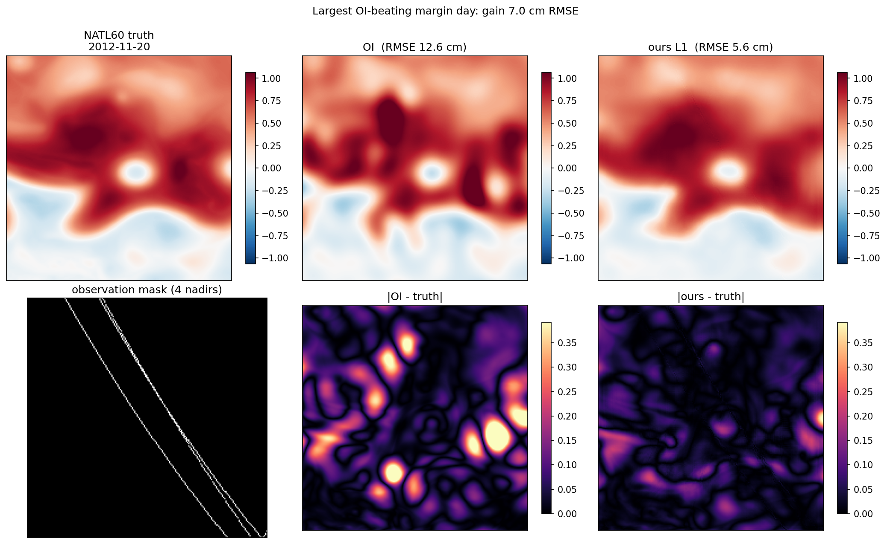

# SSH Mapping Reconstruction Project

An end-to-end, from-scratch training and evaluation pipeline for sea-surface
height (SSH) mapping on the public 2020a NATL60 observation-system simulation
experiment: sparse 4-nadir along-track altimetry in, daily gap-free 1/20-deg
reconstruction out.

The project trains a 4DVarNet-style augmented-state variational solver
(vendored in `third_party/`) per the published recipe of the method family,
evaluates with the challenge's own leaderboard metrics, and includes a
controlled experiment on per-mission adaptive fusion of the observation
increments.

## Results (official metric chain, test window 2012-10-22 .. 2012-12-02)





*(regenerate with `python scripts/make_figs.py`; the snapshot shows 2012-11-20, the test day with the largest OI-beating margin — OI 12.6 cm RMSE vs ours 5.7 cm)*

| Configuration | mu (RMSE score) | lambda_x (deg) | lambda_t (days) |
|---|---|---|---|
| OI first guess (baseline) | 0.83 ± 0.04 | 2.25 | 15.67 |
| **L1: solver trained from scratch, 120 epochs** | **0.90 ± 0.01** | 1.25 | 10.94 |
| **L2: L1 + per-mission fusion gate** | 0.89 ± 0.01 | 1.35 | 11.11 |
| reference: method-family entry on the public leaderboard | 0.94 | 0.83 | 8.03 |

Honest positioning:

- The from-scratch training recovers most of the method family's advantage
  over the OI baseline (+0.07 of the +0.11 leaderboard gap) under a fixed
  120-epoch, single-GPU budget. The remaining −0.04 is attributable to the
  budget cap (the published schedule extends past 150 epochs), single-GPU
  batch size, and training details that are not fully recoverable from the
  publications.
- The per-mission fusion experiment (L2) did not help here: the four nadir
  missions in this dataset are homogeneous sensors, so adaptive weighting of
  near-identical increments has no extra information to recover — a useful
  negative result documented in full training histories
  (`results/train_L2.json`).

## Pipeline

```
scripts/prep_data.py           gt + daily-binned pooled nadir obs  -> ssh_pilot_data.npz
scripts/oi_year.py             full-year OI first guess (challenge quickstart OI,
                               vendored mod_oi/mod_inout)          -> oi_year.npz
scripts/prep_data_missions.py  per-mission obs/mask stacks for L2  -> ssh_pilot_data_missions.npz
scripts/train_L1.py            from-scratch solver training + test-window inference
scripts/train_L2.py            same budget + per-mission fusion gate at the
                               observation-increment entry
scripts/eval_pred.py           leaderboard metrics on a prediction npz
scripts/run_resilient.sh       crash/auto-restart wrapper around either arm
```

Training recipe (both arms): augmented state [OI, m(obs−OI), m(obs−OI)] over
dT=5-day windows at 1/20 deg; ConvLSTM-gradient variational inner loop with
n_grad 5→10→15 and lr 1e-3→1e-5 on the published schedule; grouped Adam
(encoder at 0.5x lr); composite loss (MSE + gradient-MSE + AE + LR + SR terms);
train-GT normalization; best-val checkpoint selection; sliding-window center-day
inference on the test window. See script docstrings for provenance notes.

Split (official challenge split): train 2013-02-04..09-30 / val
2013-01-01..02-02 / test 2012-10-22..12-02.

## Usage

```bash
pip install -r requirements.txt

# data: place the 2020a NATL60 challenge files under $SSH_CHALLENGE_DIR
# (dc_obs/ with the four nadir NetCDF files, dc_ref/ with the daily references;
#  publicly downloadable from the challenge repository)
export SSH_CHALLENGE_DIR=/path/to/2020a_SSH_mapping_NATL60
export SSH_WORK_DIR=/path/to/workdir        # npz/checkpoints land here

python scripts/prep_data.py                 # ~10 min
python scripts/oi_year.py                   # ~50 min CPU (full-year OI)
python scripts/train_L1.py --gpu 0 --epochs 120 --tag L1
python scripts/train_L2.py --gpu 0 --epochs 120 --tag L2   # needs prep_data_missions.py first
python scripts/eval_pred.py --tag L1
```

All path defaults are overridable through `SSH_CHALLENGE_DIR`, `SSH_WORK_DIR`,
`SSH_DATA_NPZ`, `SSH_MISSIONS_NPZ`, `OI_NPZ` environment variables.

## Third-party code (vendored, unmodified)

- `third_party/4dvarnet-core/` — variational solver (CeCILL-C), pinned commit
  noted in its README.
- `third_party/2020a_ssh_challenge/` — OI first-guess modules and leaderboard
  evaluation (MIT, MEOM-IGE).
- `src/regrid.py` — scipy-based drop-in for the challenge's pyinterp regrid
  (pyinterp is conda-only); see module docstring.

## License

MIT for this repository's own code; vendored files keep their upstream
licenses (see `third_party/`).
